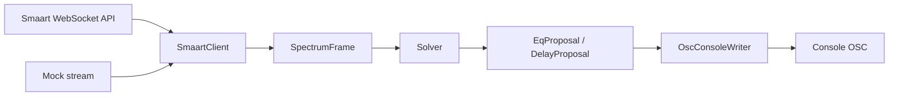

> **粵**：Auto Smaart 係用 Smaart 官方 WebSocket API 讀 live 數據，solver 建議 EQ／delay，再經 OSC 寫去 mixer；預設 dry-run，要明確 commit 先會 send。

# Auto Smaart

Foundation for **suggest-then-commit** alignment between [Rational Acoustics Smaart](https://www.rationalacoustics.com/) (v8/v9 JSON-over-WebSocket API) and mixing consoles over **OSC**.

## What it does (v0)

1. **Smaart client** — Connect to `ws://host:26000` (configurable) and subscribe to spectrum / transfer-function data using message shapes marked `TODO(SDK)` until you plug in Rational’s free API SDK schemas. Includes a **mock spectrum stream** for offline use.
2. **Solver** — Proposes parametric EQ bands (and placeholder delay) vs a flat target, with boost/cut limits from config.
3. **OSC writer** — Pluggable console map (`generic` + `x32_stub` example). **Dry-run by default**; live UDP only when `safety.dry_run: false` **and** you pass `--commit`.

We do **not** reverse-engineer the Smaart UI. Implementation targets the documented public WebSocket API; request exact JSON from Rational’s SDK.

## Architecture



## Safety model

| Control | Default | Purpose |
|--------|---------|---------|
| `safety.dry_run` | `true` | Log OSC messages only |
| CLI `--commit` | off | User intent to apply |
| `max_eq_boost_db` / `max_eq_cut_db` | 6 / 12 | Clamp proposed gains |
| `max_delay_ms` | 500 | Clamp delay writes |

Both config **and** CLI must allow apply: set `dry_run: false` and use `--commit`.

## Quick start

```bash
python3.11 -m venv .venv
source .venv/bin/activate
pip install -e ".[dev]"

cp config.example.yaml config.yaml   # optional; demo works without file

# End-to-end mock: Smaart mock → solver → OSC dry-run
auto-smaart demo --mock --frames 1 -v
# or
python -m auto_smaart demo --mock
```

Environment overrides (optional):

- `AUTO_SMAART_SMAART__HOST`, `AUTO_SMAART_SMAART__PORT`
- `AUTO_SMAART_OSC__HOST`, `AUTO_SMAART_OSC__PORT`
- `AUTO_SMAART_SAFETY__DRY_RUN=true|false`
- `AUTO_SMAART_CONFIG=/path/to/config.yaml`

## Configuration

See `config.example.yaml` for Smaart host/port, OSC target, channel map, solver and safety limits.

Console drivers:

- **`generic`** — `{prefix}/eq/{band}/{freq|gain|q}` and `{prefix}/delay` (documentation-friendly).
- **`x32_stub`** — Example stub paths for Behringer/Midas X32-style desks; **replace with real OSC addresses** from your desk manual.

## Project layout

```
src/auto_smaart/
  config.py          # YAML + env
  models.py          # SpectrumFrame, proposals
  cli.py             # demo command
  smaart/
    client.py        # WebSocket client
    mock.py          # Offline stream
    protocol.py      # SDK TODO message builders / parsers
  solver/
    engine.py        # EQ/delay proposals
  osc/
    console_map.py   # Pluggable maps
    writer.py        # python-osc UDP writer
tests/
config.example.yaml
```

## Tests

```bash
pytest
```

## Next steps

- [ ] Wire exact subscribe / TF / delay-finder / generator messages from Rational SDK docs in `smaart/protocol.py` and `SmaartClient`.
- [ ] Phase-aware delay from transfer function; target curves from file.
- [ ] Real X32/M32/Wing OSC maps behind `ConsoleMap`.
- [ ] Optional minimal web UI or REPL for reviewing proposals.
- [ ] Integration tests against a Smaart API simulator if Rational provides one.

## License

MIT — see [LICENSE](LICENSE).
